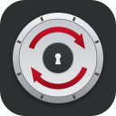

# Vault Syncryption

**Your vault, on every device, readable only by you.**

Vault Syncryption is self-hosted, end-to-end encrypted sync solution for Obsidian. You run the server, your devices hold the keys, and the server stores only ciphertext. There's no subscription, no third-party cloud and no telemetry, and it works on desktop, iPhone, iPad and Android.

> [!NOTE]
> **Testers wanted on Android and Windows.** Most testing so far has been on macOS and iOS. If you use Vault Syncryption on an Android device or on Windows, please share what works and what doesn't in [GitHub Issues](https://github.com/ibehren1/obsidian-vault-syncryption/issues).

## Why Vault Syncryption
- **Your whole setup, everywhere.** Notes, attachments, settings, themes and plugins all sync. Connect a new device and your whole Obsidian setup arrives with it.
- **A server that can't read your notes.** Everything is encrypted on your devices before upload, including file names and folder paths, so the server stores only ciphertext. Each device has its own Ed25519 encryption key for each vault. It is used both to log in and to unlock the vault, and it never leaves the device.
- **You decide who gets in.** A new device joins only when a device that already syncs the vault approves it. Every key is listed by fingerprint, and any device can remove a lost or old one. A recovery key gets you back in even if you lose every device.
- **Conflicts that resolve themselves.** Edits to different parts of the same note from two devices are merged automatically. When the same lines change on both, both versions are kept, so nothing is overwritten silently.
- **Time travel for every file.** The server keeps your file history: every version for 30 days and at least the last 10, and a deleted file's versions for 90 days. Restore any of them from "Show file history".
- **Offline-first and fast.** Each device keeps a full local copy and syncs as soon as it's back online. Live updates bring changes from your other devices within moments.
- **You're in control.** A status window shows what's synced, what's waiting to upload and what's being edited on another device. On a slow or metered connection, pause sync with one click: changes keep queuing and upload when you resume.
- **Remote-only devices.** Keep a work laptop or a phone you might lose from holding your notes in plaintext. See [Remote-only devices](#remote-only-devices) below.
- **Share a vault, not a password.** Share a vault by sharing its username and vault name. The other person generates their own key and joins once an existing device approves them.

## Remote-only devices
Some devices shouldn't keep a readable copy of your vault: a shared or work computer, or a phone that could be lost. Make such a device **remote-only** and its notes and attachments are never stored on it in plaintext. Obsidian still opens, edits, searches and links them as usual.
- **Encrypted at rest on the device.** Files on disk are empty placeholders. Their content is kept in the plugin's local store, sealed with a key that exists only in memory while the device is connected.
- **Chosen when you approve.** Approve a new device with "Approve as remote-only", or make any other device remote-only (or a full device again) later from the vault's key list on a full device.
- **Lock it from here or from elsewhere.** Lock a remote-only device's files on the device itself, or lock the device from another device of the vault. A locked device can't open its notes or sync until it is unlocked, and nothing is deleted.
- **A lease, not a promise.** A remote-only device locks by itself when it can't reach the server for longer than the vault's grace period (24 hours by default).
- **Remote wipe.** Removing a remote-only device's key deletes its copy of the vault the next time it connects.
- **No vault management.** A remote-only device can't approve or remove keys or create a recovery key, so a stolen one can't let anyone else in.
- **Compliance report.** Each remote-only device can show what it enforces right now: no plaintext on disk, File Recovery off, sealed content hashes and a valid lease.

The config folder (settings, themes, plugins) stays in plaintext so Obsidian can start. See [docs/remote-only.md](docs/remote-only.md) for how it works, a diagram of where data lives in each mode, and the limits.

## A server you'll actually enjoy running
- **One container**, configured with a few environment variables in [`backend/docker/docker-compose.yml`](backend/docker/docker-compose.yml).
- **HTTPS out of the box** with built-in Let's Encrypt, or plain HTTP behind your own reverse proxy.
- **Storage your way:** local disk by default (the `./data` folder, nothing to configure), or S3 and S3-compatible storage for effectively unlimited space.
- **An admin page** to manage users and vaults, plus a maintenance mode for upgrades.

See [docs/self-hosting.md](docs/self-hosting.md) to get it running.

## Requirements
- A Vault Syncryption server that you run yourself. The plugin does nothing without one.
  - A Docker host with a public IP and DNS. 
  - Port 80 and 443 open (80 gets forwarded to 443 but is required for LetsEncrypt setup).
- Obsidian 1.13 or later. The plugin keeps your encryption key in Obsidian's secret storage.

## Install the plugin
- **Community plugins:** Vault Syncryption is published in Obsidian's community plugins. Search for "Vault Syncryption" in Settings → Community plugins, then install and enable it.
- **By hand:** download `main.js`, `manifest.json` and `styles.css` from the [latest release](https://github.com/ibehren1/obsidian-vault-syncryption/releases/latest) into `<vault>/.obsidian/plugins/vault-syncryption/`.

### Betas
Beta versions are published to [ibehren1/obsidian-vault-syncryption-beta](https://github.com/ibehren1/obsidian-vault-syncryption-beta). To try one, install [BRAT](https://github.com/TfTHacker/obsidian42-brat) and add the beta plugin `ibehren1/obsidian-vault-syncryption-beta`. This works on desktop and mobile.

> [!WARNING]
> **Use betas with caution, and at your own peril.** Betas are untested work in progress. They may have bugs that lose or corrupt data, and they may need a newer server than the latest release. Back up your vault first, and try a beta on a test vault before your real one.

## Get started with your first device
1. Open the plugin settings and enter the server URL, a username and a vault name. Neither the user or vault name need to be preprovisioned, they just need to be unique.
2. Generate an encryption key for the device by pressing the button and give it a device name (so you later know which device the key belongs to).
3. Click Connect. Creating a new vault asks for the server's shared secret, which the server admin provides. A device joining an existing vault doesn't need it: a device that already syncs the vault approves it instead.
4. Create a recovery key when the plugin offers it. It is the only way back in if you lose every device.

The shared secret keeps strangers from creating accounts on your server. It doesn't protect your data (your encryption keys do), so an organization can treat it as an internal configuration value. Opening the server URL in a browser shows how to connect and how to contact the admin.

## Add another device
1. Create a vault on that device.
2. Install the Vault Syncryption plugin.  All other plugins will sync once connected.
3. Open the plugin settings and enter the server URL, matching username and matching vault name.
3. Generate an encryption key for the device by pressing the button and give it a device name (so you later know which device the key belongs to).
3. Click Connect. You will see a code.  On your existing Obsidian device, open the plugin and under the Approve New Keys section press Approve. Verify the code matches your new device. (Do not approve keys that you do not recognize.  Requests will timeout and disappear after 5 days.)

## Network use and privacy
- The plugin connects **only to the server URL you enter**. There is no telemetry, no analytics, and no other network traffic. If you add S3 storage, you will see puts/gets to/from the S3 provider.
- File contents, file paths and the vault key are encrypted on your device before upload. The server sees ciphertext plus some metadata: usernames, vault names and device names, file counts, sizes and timestamps (the full list is in [docs/crypto.md](docs/crypto.md), section 1).
- Your private encryption key stays in Obsidian's secret storage on each device. It is never written to the plugin's `data.json` or sent to the server and you don't need to back it up.  Create a recovery key and put that in your favorite password manager as your last resort to access a vault.
- An account on the server is needed. It is created when you create your first vault, with the shared secret from the server's administrator.

## How it reads your vault
The plugin syncs the whole vault in place, including the config folder (`.obsidian`, or whichever folder you set): settings, themes and other plugins. The Vault API doesn't cover the config folder, so the plugin uses `app.vault.adapter` for those files. Its own folder and `workspace*.json` are never synced, and each device can exclude more paths in the settings. This plugin and server are the simplest way to securely sync your vault and own you data. The entire experience is intended to be simple and secure!

## Documentation
- [docs/self-hosting.md](docs/self-hosting.md): running the server
- [docs/scaling.md](docs/scaling.md): storage growth and capacity
- [docs/remote-only.md](docs/remote-only.md): remote-only devices
- [docs/architecture.md](docs/architecture.md), [docs/protocol.md](docs/protocol.md) and [docs/crypto.md](docs/crypto.md): how it works
- [SECURITY.md](SECURITY.md): reporting a vulnerability

## Repository
| Path | Contents |
|---|---|
| `plugin/` | Obsidian plugin (TypeScript) |
| `backend/` | Sync server (Python, uv, FastAPI) and container |
| `docs/` | How it works, specifications and self-hosting |

## License
[MIT](LICENSE)
