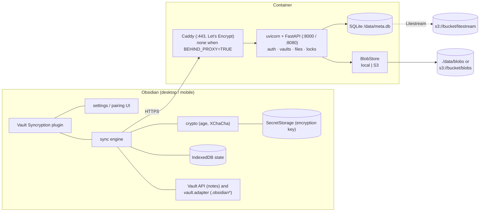
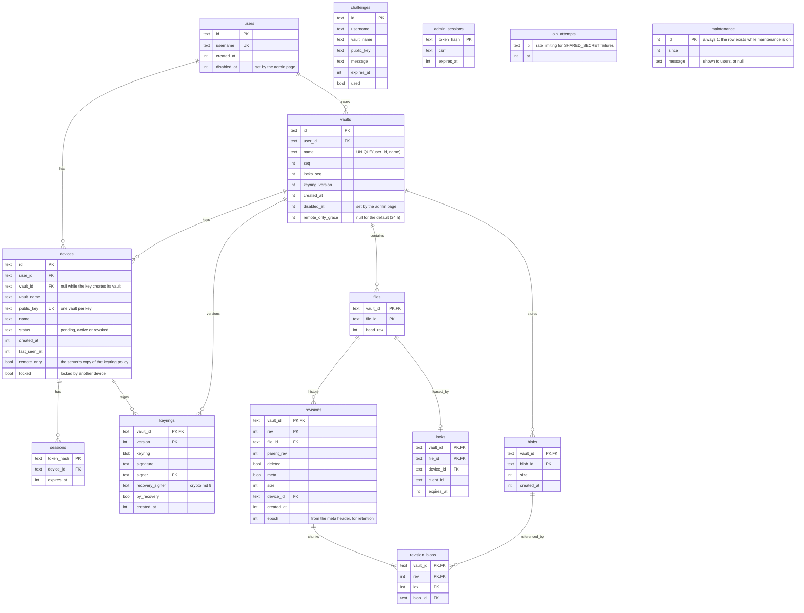
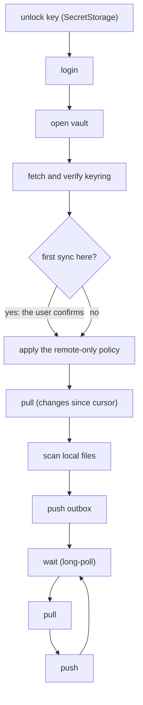

# Vault Syncryption Architecture

The wire format is in [protocol.md](protocol.md), the endpoint reference in
[api.md](api.md), the crypto in [crypto.md](crypto.md) and remote-only devices in
[remote-only.md](remote-only.md).

## 1. Overview

Everything the plugin sends is already encrypted, except the routing metadata listed in
[crypto.md](crypto.md) section 1. The server stores, orders and relays. It never merges
and never decrypts.

## 2. Backend (`backend/`)
Python 3.12, managed with uv. Package `syncryption_server` under `backend/src/`.

| Module | Responsibility |
|---|---|
| `app` | `create_app` factory (lifespan opens the database and blob store and loads the maintenance flag), hourly retention and blob GC task, `/health`, `/metrics` (unless `DISABLE_METRICS`), the HTML `/` page, the icons `/` and `/admin` link (`static/`), version headers, the maintenance `503` for `/api/v1` |
| `config` | parses and validates `BEHIND_PROXY`, `URL`, `S3_*` (including the optional `S3_ENDPOINT`), `MIGRATE_TO_S3`, `SHARED_SECRET`, `ADMIN_TOKEN`, `ADMIN_CONTACT` (optional, one line, shown on `/`, in `/health` and in disabled and maintenance errors), `DISABLE_METRICS` |
| `db` | SQLite connection (WAL mode), schema migrations (`PRAGMA user_version`), `BEGIN IMMEDIATE` transaction helper |
| `errors` | `ApiError` and the handlers that turn every error into the protocol's `{error, message, details}` shape |
| `encoding` | `b64u`, RFC 3339 times, id formats |
| `sshkeys` | devices' encryption keys (Ed25519 public keys in OpenSSH format): parsing, fingerprints, pairing codes, sshsig verification |
| `state` | per-app state: settings, database, blob store, clock, rate limiter, long-poll notifier, blob locks, the in-memory copy of the maintenance flag, metrics |
| `metrics` | Prometheus collectors in a per-app registry, the request middleware (labels by route template), the `/metrics` rendering, which counts users, vaults, keys, files, revisions, blobs and locks in SQLite at each scrape, and the container's memory and CPU read from its own cgroup v2 files |
| `auth` | challenges, sshsig verification, joining with `SHARED_SECRET`, session tokens (5 minutes for a remote-only device, so each login renews its lease), the grace period sent at login, refusing locked devices and keeping remote-only devices out of the vault's management calls |
| `devices` | the vault's keys (devices): list, approval (with the remote-only flag), removal, policy changes, locking and unlocking remote-only devices, `/devices/self` |
| `vaults` | open/create the key's vault by name, keyring versions, recovery |
| `storage` | `BlobStore` protocol, `LocalBlobStore`, `S3BlobStore` |
| `blobs` | blob upload, download and `missing`, and the garbage collector |
| `retention` | hourly pruning of old revisions (protocol.md 9.3) |
| `sync` | revision commits with the `parentRev` check, history, change feed, long-poll |
| `locks` | lease locks and `locksSeq` |
| `admin` | `/admin` page and `/admin/api` (token, session cookie and CSRF, user and vault listing, disable, enable, purge, maintenance mode, each vault's remote-only grace period) |
| `migrate` | `MIGRATE_TO_S3` one-shot copy, run by the entrypoint before serving |
| `__main__` | the entrypoint's commands: `check`, `check-data`, `render`, `migrate`, `health`, and `openapi` (the schema `npm run api-types` reads) |

### 2.1 Data model (SQLite)

- A device row is one key in one vault (`devices.vault_id`); its `status` is its access to
  the vault, so there is no separate membership table.
- The `revisions` table is the change feed: `rev` is the vault `seq`, so
  `WHERE vault_id = ? AND rev > ? ORDER BY rev` is the feed query.
- A commit is one `BEGIN IMMEDIATE` transaction: check the head, check the blobs, bump
  `vaults.seq`, insert the revision, move `files.head_rev`. SQLite serialises writers,
  which gives a total order per vault without extra locking.
- Ids are text: UUIDv4 for users and vaults, `d_...` for devices. Times are integer Unix
  seconds.
- The schema version is `PRAGMA user_version`, currently 8. An empty database is created
  at the current version; a database at version 5 to 7 is migrated step by step, each step
  in its own transaction. Versions 1 to 4 come from servers before 0.1.4 (one key for every
  vault of a user) and aren't migrated: the server and the entrypoint's `check-data` refuse
  them with a message to delete the data.
- `maintenance` and `admin_sessions` stand alone. The app reads `maintenance` at startup and
  then keeps it in memory; only the admin routes change it (protocol.md 14.1).
- There is one `sqlite3` connection for writes, used only from one dedicated database
  thread: a handler runs its queries with `await db.run(fn)`. Each stretch of queries that
  must be consistent is one `fn`, and the thread runs them one at a time, so nothing
  interleaves inside one. Work that only reads uses `await db.read(fn)` instead: five
  threads, each with its own read-only connection, run beside the writer, each `fn` in one
  read transaction, so it sees one snapshot of everything committed before it started.
  Authentication reads the session on a reader and updates `last_seen_at` on the writer
  only when it is due. Using a connection on the event loop thread, or `transaction()` in
  `read`, raises an error. Nothing is
  awaited inside a transaction; notifications, blob I/O and blob locks stay on the loop,
  between the `fn`s.

### 2.2 Blob store
```python
class BlobStore(Protocol):
    async def put(self, key: str, data: bytes) -> None: ...
    async def get(self, key: str) -> bytes: ...
    async def exists(self, key: str) -> bool: ...
    async def size(self, key: str) -> int | None: ...
    async def delete(self, key: str) -> None: ...
    def iter_keys(self, prefix: str = "") -> AsyncIterator[str]: ...
```
- Key: `blobs/<userId>/<vaultId>/<blobId[0:2]>/<blobId>`, identical in both stores.
- `LocalBlobStore` writes to a temporary file in the same directory, `fsync`s it and
  renames it into place, so a crash never leaves a partial blob under its final name.
- `S3BlobStore` uses `aioboto3`. The region comes from `GetBucketLocation` at startup. With
  `S3_ENDPOINT` set and a provider that doesn't implement it, the region is `us-east-1`.
- Blob rows are written after the store write succeeds, so a blob row always means the
  bytes are there.
- The garbage collector deletes blobs that no revision references and that are older than
  24 h: first the row, then the stored object. Uploads and the collector take the same
  per-blob lock, so an upload that arrives during collection is never half deleted.
- The collector works from the database only: it selects unreferenced `blobs` rows and
  deletes each object by its key. It never lists the store. Before it runs, `retention`
  removes old revisions (protocol.md 9.3), which is what makes their blobs unreferenced.
  Listing is used only by an admin purge (the vault's own prefix) and by `MIGRATE_TO_S3`.
  Capacity and growth are described in [scaling.md](scaling.md).

### 2.3 Long-poll
Each vault has an `asyncio.Condition`. A commit or lock change notifies it after the
transaction commits. `/wait` re-checks `seq`/`locksSeq` under the condition before
waiting, so no wake-up is lost. There is one container and one uvicorn worker, so this
in-process mechanism is enough. Turning maintenance on notifies every vault's condition,
and `/wait` then answers with the maintenance `503`. Locking a device or removing its key
wakes its `/wait`, which then finds the session gone.

## 3. Container (`backend/Dockerfile`, `backend/entrypoint.sh`)
The image is built in three stages: a `ghcr.io/astral-sh/uv` stage that installs the
locked dependencies into `/app/.venv`, the Litestream 0.5.17 release binary (checked
against a pinned SHA-256) and the Caddy 2.11 binary from the official image. The runtime
is `python:3.12-slim-bookworm`. The entrypoint uses small commands from
`python -m syncryption_server` (`check`, `check-data`, `render`, `migrate`, `health`), so
the environment rules live in one place (`config.py`).

1. `check` validates the environment (the rules are in [self-hosting.md](self-hosting.md)
   section 2), prints a one-line summary without secrets, and exits with a clear message
   on any error.
2. `render` writes the generated config into `/run/syncryption`: a `Caddyfile` when
   `BEHIND_PROXY=FALSE` (`admin off`, certificates in `/data/caddy`, `reverse_proxy` to
   uvicorn) and a `litestream.yml` when S3 is enabled. Credentials are not written to
   disk: the file refers to `${S3_ACCESS_KEY}` and `${S3_SECRET_KEY}`, which Litestream
   expands when it loads it.
3. If S3 is enabled: `litestream restore -if-db-not-exists -if-replica-exists`, so a new
   host can be rebuilt from the bucket.
4. `check-data` stops the container if `meta.db` was written by a server before 0.1.4
   (section 2.1).
5. If `MIGRATE_TO_S3=TRUE`: run the migration and stop on failure. The server is not
   listening yet, so clients see connection errors and back off.
6. Start the app:
   - `BEHIND_PROXY=FALSE`: uvicorn on `127.0.0.1:8000` with `--proxy-headers
     --forwarded-allow-ips 127.0.0.1` (so client IPs come from Caddy), and Caddy in front
     on 80/443.
   - `BEHIND_PROXY=TRUE`: uvicorn on `0.0.0.0:8080` with `--no-proxy-headers`. The app
     reads `X-Forwarded-*` itself.
   - With S3, everything runs under `litestream replicate -exec`, so the database is
     replicated while the app runs and Litestream stops when the app does.
7. The entrypoint supervises the processes with `wait -n`: if uvicorn or Caddy exits, the
   other is stopped and the container exits with an error. `docker stop` (SIGTERM) shuts
   everything down cleanly and exits 0.

The healthcheck runs `python -m syncryption_server health`, a GET of `/health` on the
local uvicorn port. It stays `200` during maintenance, so pausing sync never marks the
container unhealthy.

`backend/container-checks.sh` builds the image, checks that bad environments are refused,
starts a container behind a proxy, runs `tests/test_container.py` inside it, and checks a
clean stop. CI runs it in the `container` job.

## 4. Plugin (`plugin/`)
| Module | Responsibility |
|---|---|
| `main`, `compat`, `device` | plugin lifecycle, commands, ribbon icon and status bar, pause and resume, event wiring, the first-sync confirmation, the `SecretStorage` check, the default device name |
| `settings`, `keys`, `ui` | settings tab: endpoint, username, vault name, device name, encryption key generation (the key goes to `SecretStorage`), exclude list. Join, passphrase, pairing, approval, first-sync and reload dialogs, the recovery key dialog, file history and restore, the status window (`ui/status`), the icons (`ui/icon`), the remote-only compliance report (`ui/compliance`) |
| `obsidian` | `requestUrl` transport, and the `VaultFs` over the Vault API |
| `crypto` | OpenSSH key parser/writer, age `ssh-ed25519` recipient/identity, sshsig, keyring, file and metadata objects, path and key derivation (`kdf`), sealing under a remote-only device's local key (`local`, crypto.md 11) |
| `api` | typed client over a `Transport` (`requestUrl` in the plugin, `fetch` in tests). `src/api/schema.ts` is generated from the server's OpenAPI with `npm run api-types` (CI checks it is current) |
| `sync` | vault session (login, join, create or open the vault, pairing, keyring pinning), sync engine, scanner, merge, conflict copies, path filter, file encryption (`cipher`), the `VaultFs` over `vault.adapter` for the config folders and `SplitFs`, which sends hidden paths there and the rest to the Vault API, lock manager, long-poll loop |
| `store` | IndexedDB (`idb`, behind the `SyncStore` interface in `state`): cursor, path table, outbox, pinned keyring. On a remote-only device, the sealed content hashes (`sealed`) and the store of sealed file content (`entries`) |
| `remote` | remote-only devices ([remote-only.md](remote-only.md)): the wrapped `vault.adapter` that serves sealed content behind zero-byte stubs (`stub-adapter`), the `VaultFs` that reports the real size and times of those files (`stat-fs`), the lease, the wipe on removal and the Obsidian wiring (`remote-only`), and the compliance report (`compliance`) |

### 4.1 Local state (IndexedDB)
One database per Obsidian vault and remote vault: `syncryption-<installId>-<vaultId>`. The
install id is a random UUID in `app.saveLocalStorage`, which Obsidian keeps per vault, so
two local vaults never share state. If the stored vault id doesn't match, the database is
cleared.

| Store | Contents |
|---|---|
| `meta` | `cursor`, `vaultId`, pinned keyring `keyringPin` `{version, sha256}`, `deferred` (remote revisions held back until the end of a pull, see 4.2), `failed` (remote revisions that couldn't be written here, tried again on every pull) |
| `files` | `path → {fileId, rev, deleted, sha256, size, mtime}`: the last synced state of each file |
| `outbox` | `path → {path, id, queuedAt}`, one entry per path. Whether it is an upload or a deletion is decided when it is pushed, from the file on disk. A push removes the entry only if its `id` is unchanged, so a change made during the push is not lost |

A remote-only device ([remote-only.md](remote-only.md) section 7) stores `files.sha256`
sealed under its local key, and the content of its notes and attachments in a second
database, `syncryption-<installId>-<vaultId>-remote`.

There is no store of merge bases: the base is the synced revision, fetched from the server
with `GET /files/{fileId}/revs/{rev}` when a merge needs it. A merge therefore needs the
server, which a merge always does anyway (it starts from a remote change).

### 4.2 Sync loop

- **Pull:** for each change, decrypt the metadata, check it (crypto.md 8.3), and compare
  with `files`. The local file is always hashed first, so a stat that looks unchanged
  can't let a remote write replace an edit. If the local file is unchanged since the last
  sync, write the remote version. If both sides changed, merge. Equal content is adopted
  without a write. A revision that fails its checks is skipped with a warning. If writing
  a revision fails (a name this file system refuses, or one that differs only in case from
  another file on a case-insensitive file system), it is kept in `meta.failed`, a warning
  is shown once, and the pull goes on; every later pull tries it again.
- **Deletions:** a remote deletion of a file edited here keeps the edit and commits it on
  top of the deletion. A local deletion of a file edited elsewhere loses to the edit.
- **Push:** for each outbox entry, read the file, encrypt the chunks, upload the missing
  blobs, then commit with `parentRev` from `files`. On `409`, apply or merge the head
  returned in the error, which queues the result for the next push round (at most 5 per
  sync). A `400`, `413` or `422` for one file keeps it queued and the sync goes on.
- **Live updates:** `LiveLoop` long-polls `/wait` (protocol.md 10.2). A new `seq` runs a
  sync; a new `locksSeq` refetches the lock list. Local changes sync 2 seconds after the
  last one, and a 2-minute timer is the fallback when a wait is lost. When the app comes
  back to the foreground or the network returns, the loop's backoff ends and a sync runs;
  if connecting failed for want of a network, the plugin connects again then and on the
  timer. Every request gives up after 60 seconds (`NetworkError`), so one that hangs while
  a mobile app is suspended doesn't stall later syncs.
- **Locks:** `LockManager` holds a soft lock on the mergeable note in the active editor
  and renews it every `ttl / 2`. The `clientId` is 16 random bytes in the app's local
  storage. If another device holds the note, a notice says so once, and a status-bar item
  shows "<device> is editing" while that note is active. Locks never block an edit or a
  commit: a concurrent edit still goes through the 409 merge.
- **Merge:** text files (by extension: md, txt, canvas, base, json, css, js, csv, tsv,
  yaml, yml, html, xml, svg) go through diff3 (`node-diff3`) with the base revision. A
  clean result is committed; JSON and canvas results must still parse. Otherwise the
  remote version wins the path and the local version is saved as
  `name (conflict <device> YYYY-MM-DD HHmm).ext`, with ` 2`, ` 3`... for more copies in
  the same minute. Binary files always get a conflict copy.
- **Files on disk:** notes and attachments go through the Vault API (`ObsidianFs`), so
  Obsidian's index stays current. Obsidian doesn't index hidden folders, so every
  `.obsidian*` folder at the vault root (the active `configDir` and the profiles of other
  devices) is listed, read and written through `vault.adapter` (`AdapterFs`). If an
  adapter can't list the vault root, only the active `configDir` is synced. Other hidden
  files and folders aren't synced.
- **Config files:** a pull holds back the active `configDir/community-plugins.json` and
  writes it after everything else, so plugins are on disk before Obsidian turns them on.
  The held-back revisions are saved in `meta.deferred` before the cursor moves past them.
  After a sync that wrote to the active `configDir`, the plugin asks once per session to
  reload Obsidian (`app:reload`). On a device's first sync of a config file (no synced
  state, both sides have it), the vault's version replaces the local one without a
  conflict copy, so a new device takes the vault's settings instead of pushing its
  defaults as conflicts. After that, config files merge like notes (JSON must still parse).
- **History and restore:** "Show file history" (also "Sync history" in the file menu)
  lists a file's revisions newest first, 50 at a time, from `GET .../revs`. Each row comes
  from the decrypted metadata (size, deletion, the writing device, named from the
  keyring); revisions that fail their checks are left out and counted. Text files can be
  previewed. Restoring syncs first, so unsynced local edits become a revision of their
  own, then writes the old content to the file and commits it as a new revision on top of
  the head, so a restore never rewrites history. The server prunes old revisions
  (protocol.md 9.3), and the dialog says what it keeps. "Restore a deleted file" lists the synced paths
  whose last revision is a deletion and opens the same history.

- **Pairing:** a new key of an existing vault is pending; it shows its pairing code and
  polls every 5 seconds. On an active device, "Approve devices" lists the vault's pending
  keys with codes computed locally from their public keys. Approving adds the key to the
  keyring, uploads the next version (retrying on `409 keyring_version`), then approves the
  key on the server.
- **Recovery key:** offered once after this device creates a vault, and in the settings
  (create, replace, remove). A new key is shown once and set only after the user confirms
  they stored it. The pairing dialog has "Use a recovery key": the device opens the
  current keyring with it, adds itself, and uploads the next version signed by the
  recovery key; the server activates the key and connect goes on at the next poll
  (crypto.md 9).
- **Removing a key:** the settings list every key of the keyring (fingerprint, device
  name, date added, with status and last seen from the server), this device's marked.
  "Remove" (on any key but this device's) revokes the key on the server, then uploads
  the next keyring without it under a new epoch. If the removed device set the recovery
  key, that goes too and the user is asked to create a new one. On connect, keyring
  keys that are no longer active on the server are removed the same way (crypto.md 8.4).
- **Re-encryption:** each sync ends by committing again, under the current epoch, the
  unchanged live files whose last synced revision used an older one (`SyncedFile.epoch`).
  The engine fetches the keyring when the change feed reports a newer version, or once
  when a revision uses an unknown epoch.
- **Keyring pinning:** on connect, the pinned version is fetched again and compared with
  the pin, then every later version is checked in order (crypto.md 6.4).
- **First sync:** when a device connects to a vault it has never synced (no cursor in its
  local state), a dialog shows the server, the vault, the device name and key fingerprint,
  the number of local files, whether the server vault is empty and what the sync does.
  The sync starts only when the user confirms; "Not now" disconnects, and the next connect
  asks again. The sync then runs in the background, with a notice showing its progress.
- **Remote-only devices:** on connect, the keyring's policy for this device decides
  whether it is remote-only. A remote-only device keeps its notes and attachments on disk
  as zero-byte stubs, with the content sealed under a local key, and can't manage the
  vault (approve, remove, recovery). Its sessions last 5 minutes, and each login renews
  its lease; when the grace period passes without a renewal, the files lock. Details are
  in [remote-only.md](remote-only.md).

### 4.3 Change detection
- The Vault API's `create`, `modify`, `delete` and `rename` events cover notes and
  attachments. The undocumented `vault.on('raw')` event covers the hidden config folders;
  only its hidden paths are used.
- A scan on every sync (and so on startup) compares `mtime`/`size` with `files` and
  hashes candidates, as a fallback. On a remote-only device the scan sees each file's
  real size and times, not the stub's.
- Excluded paths (section 4.4) are filtered before anything is queued.
  A scan doesn't descend into excluded folders such as `node_modules`.
- **Exclude list:** one pattern per line in the settings, kept per device in the plugin's
  `data.json` (which is itself never synced). A pattern is vault-relative and matches the
  path or anything inside it; `*` and `?` match within a path segment and `**` across
  segments. Lines starting with `#` are comments. Excluding a synced path stops syncing it
  without deleting it anywhere.

### 4.4 Sync scope
- The whole vault is synced in place, including `app.vault.configDir`. It is not a nested
  vault.
- Notes and attachments go through the Vault API, so Obsidian's index stays current. The
  hidden `.obsidian*` folders go through `app.vault.adapter`. Both work on desktop and on
  mobile.
- Every `.obsidian*` folder at the vault root is synced, so a device can use its own
  profile through Obsidian's "Override config folder" setting.
- Never synced (`sync/filter.ts`):
  - the plugin's own folder, `plugins/vault-syncryption` in every config folder
  - `workspace.json`, `workspace-mobile.json` and `workspaces.json` at the top of a config
    folder
  - `.trash`, `.git` and `node_modules` folders, and `.DS_Store`, `Thumbs.db` and
    `desktop.ini` files, at any depth
  - hidden files and folders outside the `.obsidian*` folders (Obsidian doesn't index them)
  - the paths matched by the device's exclude list (section 4.3)
- `community-plugins.json` is written last, and the user is asked to reload Obsidian. On a
  device's first sync, the vault's config files replace the local defaults without
  conflict copies (section 4.2, Config files).

### 4.5 Mobile
The plugin uses no Node APIs outside desktop-only code: WebCrypto, `@noble/*`,
`requestUrl` and long-poll. On phones:
- **Large files:** a file is read, hashed, encrypted and decrypted whole, on the main
  thread. Peak memory is about 2x the file size when uploading and about 4x when
  downloading, so files of a few hundred MB may get the app killed on a phone.
- **Unicode normalization:** `fileId` uses the NFC form of a path, but files are written
  under the name as sent. A file named in NFD on one device and NFC on another (rare:
  macOS keeps both) can show up twice on Android.
- **Device names:** a phone has no hostname, so its default device name is "iPhone",
  "iPad", "Android phone" or "Android tablet" (desktops use the hostname). Several phones
  of the same kind look alike in approvals, conflict copies and "is editing" notices until
  they are renamed in the settings.
- **Scans:** every sync scans the vault and the config folders (one `stat` per config
  file), which costs battery on large vaults.
- **Passphrases:** a stored encryption key that has a passphrase asks for it on every cold
  start, and iOS restarts apps often. Keys the plugin generates have no passphrase.

## 5. Repository and CI
- `testvectors/` is read by both the pytest and the vitest suites.
- CI (Gitea Actions, `.gitea/workflows/ci.yml`) runs on every PR and on pushes to `main`,
  in three jobs:
  - `backend`: `uv sync --locked`, `ruff check`, `ruff format --check`, `pytest`.
  - `container`: `backend/container-checks.sh` (section 3).
  - `plugin`: checks that the root `manifest.json` and `versions.json` match the plugin's,
    then `eslint`, `npm run api-types -- --check`, `vitest` and the build. The tests run
    against the real backend (started with uv) and against `ssh-keygen` and the Go `age`
    CLI for interop, and fail rather than skip if either is missing (`REQUIRE_BACKEND=1`,
    `REQUIRE_AGE=1`).
