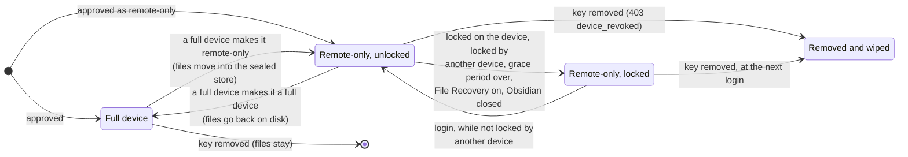
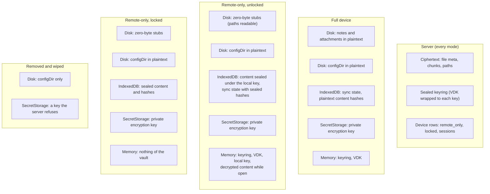

# Remote-only devices

Remote-only devices work on desktop and iOS. Android is untested.

## 1. Goal
A remote-only device keeps no vault plaintext on disk. Note and attachment contents are
stored on the device only sealed under a local key derived from the keyring, and the
plugin decrypts them in memory when Obsidian reads a file. Removing the device's key from
the vault leaves everything on the device useless: the device can no longer get the keyring,
so it can no longer decrypt its own copy.

The use cases:
- A lost or stolen laptop or phone: remove its key and the data on it stays closed.
- A shared vault: when a member leaves, removing their key cuts them off. They keep no
  readable copy, as long as their client followed the rules while they were a member
  (section 3).

Whether a key is remote-only is decided when it is approved into the vault, and a full
device can change it later. The rest of Obsidian works as on a full device.

### 1.1 Modes and where data lives
A device is in one of these modes. The arrows are what moves it between them.

Where each piece of data is in each mode:

The local key is derived from the keyring (crypto.md 11), and the keyring is only in
memory and only from the server. So the sealed store on a locked device can't be opened
without a successful login, and a removed or locked key can't log in.

## 2. Why removal closes the data
- The plugin never stores the VDK or the decrypted keyring. It keeps them in memory, and
  stores only a pin (`{version, sha256}`) for rollback checks ([crypto.md](crypto.md)
  section 6.4).
- The device's private key, in `SecretStorage`, decrypts only the keyring. The keyring lives
  on the server, which hands it out only to active devices of the vault.
- A remote-only device seals its local copy under a key derived from the keyring
  ([crypto.md](crypto.md) section 11), so the copy can't be opened once the server refuses
  the keyring.
  That happens as soon as the key is removed: removal deletes the device's sessions, and
  every later login returns `403 device_revoked` ([protocol.md](protocol.md) section 6).
- Removal rotates the epoch ([crypto.md](crypto.md) section 8.4), so the device
  can't read anything written afterwards either.

No extra key from the server is needed. What a remote-only device adds is:
- it never writes plaintext content to disk,
- it never stores the keyring, and
- it stops using the keys it holds in memory when it can't reach the server for too long.

## 3. Threat model
**Protected after the key is removed:**
- A lost or stolen device, including someone reading its disk directly.
- A member who leaves a shared vault, as long as their client was the official plugin and
  it followed the rules below while they were a member.

**Not protected:**
- A member who copies data while still a member. While the vault is open the plaintext is
  on screen and in memory. They can copy and paste or export notes, read the VDK with the
  developer tools, save a keyring response together with the private key from
  `SecretStorage`, or run a modified plugin that ignores this policy. No client-side design
  can prevent that. Remote-only makes data on a device **revocable at rest**. It does not
  stop someone exfiltrating it.
- A device that is taken before its key is removed. Until removal, it can still log in.
- Paths. Remote-only uses stub files (section 6), so file and folder names stay in
  plaintext on the device's disk.

**Enforced by the server:** short sessions (the lease, section 5), and refusing the keyring
and all data to a removed key.

**Enforced only by a well-behaved client:** keeping plaintext off disk, locking when the
lease runs out, and wiping on removal.

### 3.1 Plaintext outside the plugin's control
Obsidian and other plugins keep their own copies of some content. The plugin checks for
File Recovery (section 10) but doesn't remove any of these copies, and none of this is
cryptographic:
- **Obsidian's metadata cache** (IndexedDB) stores headings, links, tags, frontmatter and
  section data in plaintext.
- The **File Recovery** core plugin stores full plaintext snapshots in IndexedDB. A
  remote-only device refuses to start syncing while it is enabled.
- **`workspace*.json`** lists open and recent files.
- **Other plugins** may cache content (for example a full-text search index), or read files
  from the disk directly. Plugins that read the disk see the empty stubs instead of the
  content.
- **The operating system** may write memory to swap or crash dumps.

## 4. The policy
- The policy is a field in the device's entry of the signed keyring plaintext
  ([crypto.md](crypto.md) section 6.1): `"policy": "remote-only"`. If it's absent, the device
  is a full device. The device being approved reads its policy from the keyring it opens.
  The server is untrusted for integrity, so a flag held only on the server could be removed
  by a malicious server, making the device write plaintext.
- The approving device sets it, through a choice in the approval UI ("Approve as
  remote-only").
- Clients check, while they follow the keyring chain ([crypto.md](crypto.md) section 6.4),
  that:
  - only a full device sets, changes or removes a policy, and
  - a keyring update signed by a remote-only device changes no `devices` entry except
    through epoch rotation, and doesn't change the recovery key.
- **A remote-only device can't manage the vault.** It can't approve or remove keys, set or
  replace the recovery key, or replace its own key. A recovery key it set would give it a
  lasting copy of the VDK. The client hides these actions, the server refuses them
  (`403 remote_only`), and other clients reject keyrings that break the rules above.
- The server keeps a copy (`devices.remote_only`) so it can shorten the sessions and refuse
  management calls. Approval takes an optional body `{"remoteOnly": true}`. The field is
  optional, so `PROTOCOL_VERSION` is unchanged.
- **Changing the policy later.** A full device can make another active device remote-only,
  or a full device again ("Make remote-only" and "Make full device" in the vault key list).
  It uploads a keyring with the new policy first, then tells the server
  (`PUT .../devices/{id}/policy`, [protocol.md](protocol.md) section 6), which wakes the
  vault's long-polls. The changed device sees the new keyring at its next sync and
  connects again to follow it: becoming remote-only moves its files into the sealed store,
  becoming full puts them back on disk. A device can't change its own policy: a
  remote-only one can't manage the vault, and a full one asks another full device.

## 5. Lease and grace period
- A remote-only device's sessions last 5 minutes (`SESSION_TTL` is 1 hour for full devices).
  When a session expires, the device's next request gets `401` and logs in again; the
  long-poll sends one at least every 25 s while the device is online. Each successful
  login renews the lease. Offline, nothing renews it.
- The long-poll checks the session again when it wakes, so a removed device is cut off at
  once, not at the end of the current 25 s wait.
- **Grace period:** how long the device may go without renewing its lease before it locks.
  The server administrator sets it: the default is 24 hours, and it can be changed per vault
  on `/admin` (`vaults.remote_only_grace`, `NULL` meaning the default). The server sends it
  in the `/auth/verify` response (`graceSeconds`). The plugin compares the time since its
  last successful login with it every 30 seconds, when the app comes back to the
  foreground, and at every sync tick. The value comes from a server that isn't trusted, which is
  acceptable: a server can only lengthen a lock that depends on the client anyway, and it
  still can't decrypt anything.
- **Locking** happens when the grace period passes without a renewal. The device:
  - disconnects, which drops the keyring and the VDK from memory,
  - drops the local key and the `blob:` URLs of decrypted resources, and
  - makes reads and writes of remote-only files fail, and shows why.

  Editors that are already open keep showing what they loaded, but can't save. The device
  unlocks at the next successful login.
- **Locking by hand.** The device's own user can lock its files at any time ("Lock
  remote-only files", in the status window and in the compliance report). That locks as
  above, disconnects and forgets the unlocked encryption key. "Unlock remote-only files"
  connects again.
- **Locking from another device.** A full device can lock a remote-only device ("Lock" in
  the vault key list, `PUT .../devices/{id}/lock`). The server ends its sessions and
  refuses its logins and requests with `403 device_locked` until a full device unlocks it.
  The locked device locks its files, keeps everything (nothing is wiped) and tries again
  at every sync tick, so it opens again by itself once unlocked. Use it for a device that
  is missing but may come back; remove the key when it won't. Making the device a full
  device also clears the lock.
- **A cold start offline stays locked.** The keyring is never on disk, so with no server
  there is nothing to decrypt with. This is what makes the data useless after removal.
- **On `403 device_revoked`** the device:
  - locks,
  - deletes every note and attachment (everything outside the hidden folders) through the
    adapter, so changes not uploaded yet are lost,
  - deletes both of the vault's databases (sync state and sealed content),
  - forgets the vault, and
  - shows "This device was removed from the vault."

  `configDir` and Obsidian's own caches (3.1) stay. Only the official plugin does this.

## 6. Presenting files to Obsidian: stub files
Obsidian reads `configDir` (`app.json`, `community-plugins.json`, the plugins' `main.js`)
from disk before any plugin loads, so **`configDir` stays as normal files**. Remote-only
covers notes and attachments only. `configDir` syncs as on a full device, in plaintext,
with the usual exclude list.

For every note and attachment:
- A **zero-byte stub** sits at the file's real path. Obsidian's startup scan builds the file
  tree from the stubs.
- The plugin wraps `app.vault.adapter` and serves the real content from its encrypted
  store. It wraps `read`, `readBinary`, `write`, `writeBinary`, `append`, `appendBinary`,
  `process`, `stat` (the real size and times), `copy`, `rename`, `remove`, `trashSystem`,
  `trashLocal` and `getResourcePath`. For images, PDFs, audio and video,
  `getResourcePath` returns a `blob:` URL. It is synchronous, so a resource not decrypted
  yet gets the stub's URL and is decrypted in the background (the embeds of an opened note
  are started first). Every view that got the stub's URL is shown the resource once it is
  ready, including when it was already being decrypted and when the sync only brings the
  file later: reading view renders again, and in Live Preview, which keeps the embeds it
  rendered, the image, video and audio elements still showing the stub's URL get the
  `blob:` URL directly. A resource decrypted from content that was written over
  meanwhile is dropped.
- Writes go only to the store. The stub stays empty.
- Paths in `configDir` go to the real adapter unchanged.
- After the plugin loads, it makes Obsidian index the files again, because the startup
  index saw only empty stubs.
- While locked, reads of remote-only files fail. The stubs stay, so the tree still shows.

The alternative, files that exist only in memory with nothing on disk, would also hide the
paths. But it needs Obsidian's private file-tree internals, on desktop and on mobile, and
those can change in any update. Stubs need only the documented `DataAdapter` methods. The
methods are wrapped, which is still fragile, but it is far less code.

## 7. Local store
- **Content:** a database of its own, `syncryption-<installId>-<vaultId>-remote`, so the
  wipe can delete it whole. Three object stores:
  - `entries`, keyed by path: each file's entry, with a random 16-byte entry id and its
    chunk count;
  - `chunks`, keyed by `[entry id, index]`: the content in chunks of up to 4 MiB, each
    sealed under the local key ([crypto.md](crypto.md) section 11), one transaction per
    chunk;
  - `info`, keyed by path: size, times and the entry id, so listing doesn't load the
    content.
- **Chunks, so no file is ever whole in memory while it syncs.** A write seals its chunks
  under a new entry id first and writes the entry last, in a transaction that also drops
  the previous version's chunks. A crash in between leaves chunks no entry names, and
  they are deleted at the next load. Entries written before chunks hold their content
  sealed whole; they stay readable and are chunked at their next write.
- **Sync goes through the wrapper.** The engine reads and writes notes through the Vault
  API like on a full device, and the Vault API goes through the wrapped adapter. A
  `VaultFs` decorator (`RemoteStatFs`) reports the stored size and times, as `TFile.stat`
  has the stub's (size 0) and the scan would hash every file on every sync.
- **Downloads are streamed into the store.** Each chunk is downloaded, checked, decrypted
  and sealed under the local key before the next one is fetched. The file's hash is
  checked after the last chunk, and only then does an empty write through the Vault API
  commit the entry and touch the stub, so Obsidian sees the change as for any other write.
  A chunk or hash that fails its check leaves nothing behind. Hashing a stored file (the
  scan, and the check before a remote change replaces it) reads it one chunk at a time
  too. A file is read whole only when Obsidian opens it, or when it is uploaded.
- **Sync state:** the same database as a full device. Its plaintext content hashes
  (`files.sha256`) would let anyone confirm a guess of a file's content, so a remote-only
  device stores them sealed (`s1:`, crypto.md 11). Storing a file fails while locked.
- Paths are in plaintext on disk anyway (the stubs), so keying by path hides nothing more.
- **A stub is never content.** An empty file on disk with no entry in the store is a stub
  whose content is missing (the store was lost, or never filled). Reading it fails
  (`MissingContentError`) instead of returning empty content. The sync engine then
  downloads the file's head again and never commits the stub. Only the first conversion,
  when a full device becomes remote-only, takes empty files as empty notes.
- **Disconnecting stops a running sync.** Locking, losing the connection to a lock from
  another device, and unloading the plugin close the engine. A sync that is still running
  fails at its next write or commit, so it can't commit what it reads after that.
- **Back to a full device without converting back.** Writing a file back to disk fires
  Obsidian's `modify` event, and a remote-only device moves a file written outside the
  wrapper into the store. During the restore that would move each file back and leave an
  empty stub, and the store is deleted right after. So once the restore starts, the
  wrapper converts nothing, and the store is deleted only when every file is back on disk.
- An offline edit is sealed when it is written. Nothing decrypted is kept beyond
  Obsidian's own caches and the `blob:` URLs of resources, which are dropped on lock.

## 8. Implementation
**Backend:** `devices.remote_only`, `devices.locked` and `vaults.remote_only_grace`; the
approve body; 5-minute sessions and `graceSeconds` in `/auth/verify`; the long-poll
checking the session when it wakes; `403 remote_only` on approve, remove, recovery and key
replacement; the policy and lock endpoints and `403 device_locked`; and the grace setting
on `/admin`.

**Plugin:**
- `crypto/keyring.ts`: the `policy` field and the chain rules, with test vectors.
  `crypto/local.ts` and `deriveLocalKey`: the local key.
- `remote/stub-adapter.ts`: the wrapper. `store/entries.ts`: its IndexedDB store.
  `store/sealed.ts`: the sealed hashes. `remote/stat-fs.ts`: the real sizes for the scan.
- `remote/remote-only.ts`: the controller.
  - **At load:** if this device is remote-only (`syncryption-remote-only` in local
    storage, `{vaultId}`), the wrapper is installed locked before anything else.
  - **After each connection** it follows this device's policy in the keyring. If the
    keyring says remote-only, it checks File Recovery, unlocks, seals the hashes, turns
    every file still on disk into a stub and has Obsidian index the notes again. If the
    keyring says full but the device is still remote-only, every file goes back on disk
    and the store is deleted. Remote-only files of another vault stop sync with an error.
  - **Lease:** every 30 seconds, on wake-up and at every sync tick, the device checks the
    time since its last login against the grace period. When it has passed, or File
    Recovery is on, it locks, disconnects and shows why. The next successful connection
    unlocks it.
  - **Removal:** on `403 device_revoked` (from a sync, a login or the long-poll) it locks,
    deletes every note and attachment (everything outside the hidden folders) through the
    adapter, deletes both databases of the vault, and forgets the vault. Changes not
    uploaded yet are lost with it. `configDir` stays.
  - A file written to disk by something other than Obsidian is moved into the store on its
    `create` or `modify` event.
- **Approval:** the approval dialog has "Approve as remote-only" next to "Codes match,
  approve". The approving device adds the key with the policy, then approves it on the
  server with `{"remoteOnly": true}`.
- **No management on a remote-only device:** the settings and the status window hide
  approving and removing keys, the recovery key and key replacement. It doesn't offer a
  recovery key and doesn't finish other devices' removals.
- **Changing another device:** the vault key list of a full device has "Make
  remote-only" or "Make full device" for every other key, and "Lock" or "Unlock" for a
  remote-only one. `VaultSession.setPolicy` updates the keyring, then the server. After
  each sync, a device whose keyring policy differs from its local flag connects again.
- **Lock and unlock on the device:** commands, a button in the status window and
  one in the compliance report. `403 device_locked` locks the files and leaves the device
  offline, retrying.
- **Compliance report** (section 10).

## 9. How Obsidian uses the adapter
Checked in Obsidian 1.14.4's desktop `app.js`, and tested on macOS desktop and iOS
(Android is untested):
- **`Vault.read`, `readBinary`, `cachedRead`, `modify`, `process` and `copy`** call
  `this.adapter.<method>(path)` on the adapter instance. Replacing the methods on that
  instance catches them. `cachedRead` is served from `Vault`'s own in-memory content cache
  when it can be, and that cache is filled from those reads.
- **The metadata cache** reads notes through `vault.readBinary`, so it gets the decrypted
  content. It reuses a cached entry when the file's `mtime` and `size` match. Those come
  from the disk, which means the stub (size 0). A write through the wrapper gives the stub
  the new `mtime`, so Obsidian sees the change and indexes it again.
- **After a write**, the desktop and mobile adapters both `stat` the file on disk
  (`reconcileInternalFile`) and update `TFile.stat` from that. So `TFile.stat.size` is 0
  for stubs: the wrapped `adapter.stat` returns the real size, but `TFile.stat` doesn't use
  it. Obsidian's file sizes are cosmetic; the sync scan gets the real sizes from
  `RemoteStatFs` (section 7).
- **`getResourcePath` is synchronous.** Electron's `app://` protocol is handled in the main
  process, and Obsidian doesn't register a service worker, so a plugin can't serve
  decrypted bytes behind a URL on demand. The wrapper returns a `blob:` URL once the file
  is decrypted. On a cache miss it returns the stub's URL (empty), decrypts in the
  background and asks the views to render again. It also decrypts a note's embeds when the
  note is opened.
- **`getFullPath`** (the real path on disk) is used outside the adapter only for "Copy path"
  and opening a file in another app. Those see the stub.
- Checked on desktop and iOS: the file tree, opening, editing and saving notes; rename,
  move and delete; links, backlinks, tags and search; embedded images, PDFs and audio;
  Canvas and Bases; restarting Obsidian; locking and unlocking.

## 10. Compliance report
"Show remote-only compliance report" (also a button in the status window) checks the
device now and shows the result:
- the policy, from the keyring when connected, or what the device remembers;
- that the policy is remembered and the wrapper is installed;
- that no remote-only file has content on disk (lists the ones that do);
- that File Recovery is off;
- that the content hashes are sealed;
- that the lease is valid or the files are locked;
- the details: locked or not, the last renewal, the grace period, the number of
  remote-only files and of stored entries, and any mismatch between them.

It says "Compliant" only when every check passes. It checks only what the plugin enforces:
the caches in 3.1 are outside it, and File Recovery snapshots taken before the device
became remote-only stay in File Recovery's own database.
